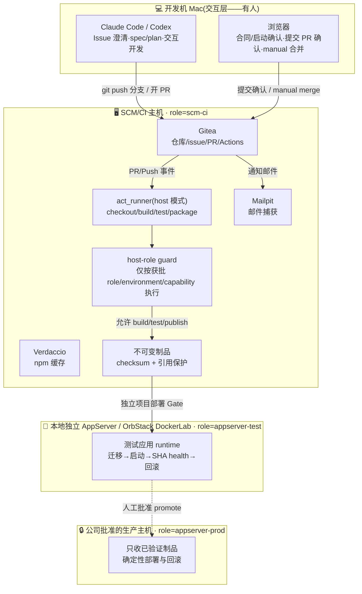
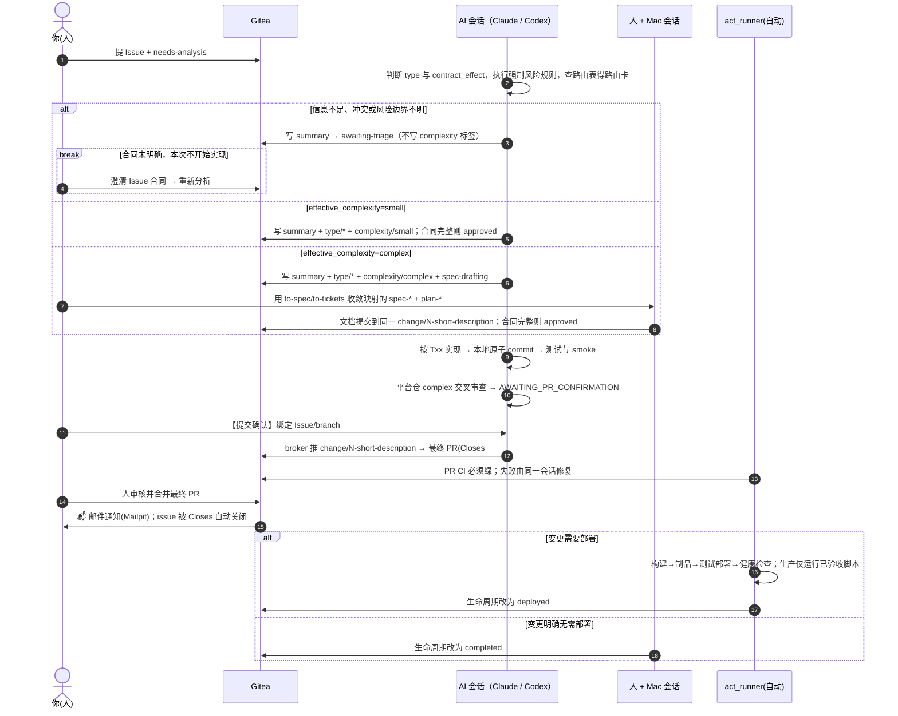

# 软件开发与自动化部署运维平台 · 总纲

> 一句话：**Issue 定义工作，AI 会话把明确合同做到最终 PR；人确认提交，人合并；部署始终独立授权。** 平台没有无人值守的执行引擎（[ADR 0002](docs/adr/0002-deterministic-development-flow.md)）。

本文件是全貌与导航；细节在各主题分册，每册开头一段「现行合同」、文末一张「来历」表。原始设计文档在 [archive/](archive/)，仅作历史参考。平台边界见 [ADR 0001](docs/adr/0001-platform-boundary.md)，整改进度见 [整改路线](docs/governance/remediation-roadmap.md)。

---

## 1. 状态怎么读

“稳定源码”指 Gitea 受保护 `main` 上已经人工合并的版本，不等于本机已安装、项目已采用或公司已部署；
source、本机安装、项目采用与现场运行是各自独立的证据层。本文不手写状态，当前状态由工具从源码与本机读出：

```bash
# 源码事实（只读源码，不调用 broker）：治理仓库数、broker 操作数、installer 数、标签数、发布包版本、外部技能包 pin
bash codex/tools/aisoft-platform-readiness.sh --render-readme
# 本机安装与 live 读回（只读，在 Mac 上跑；VM 只跑 drift --host vm，见 06 §1）
bash codex/tools/aisoft-platform-readiness.sh
bash codex/tools/check-installed-drift.sh
```

仓库名单、分类与 required contexts 以 [governance manifest](codex/config/gitea-governance.json) 为准，站点值以
[broker manifest](codex/config/host-access-broker.json) 的 `site` 段为准，使用发布包版本以 `usage/bundle.json` 为准。
尚未实施或尚未现场验收的事项集中在 §8「未实施清单」。历史完成条目见 [平台状态历史](archive/平台状态历史-20260902.md)。

## 2. 目标职责架构

下图展示 Linux 容器交付参考路径；PM2/SQLite **as-built legacy 试点**另见 [02](02-CI与自动部署流水线.md)。
采用容器交付的项目使用受控 builder 一次构建 `linux/amd64` OCI images，由 Gitea Container Registry
或同一 manifest 的 offline bundle 传到隔离的 test/prod trust role；SCM/CI 主机只承担 SCM 与明确
批准的 CI/CD 能力。仅测试的共置合同：受保护部署 profile 显式声明 `host_role=scm-ci` 且
`environment=test` 时可承载隔离测试应用，生产仍须分离。
具体发布实现由项目仓自带；平台原 Docker release 参考实现已迁出，见 [迁出说明](archive/reference-implementations-exit-261019.md)。



上图是新项目与收口后的强制职责合同，不是对当前 live 状态的描述；环境健康须重新只读核对。

采用**两台公司 Linux VM + 本地 OrbStack DockerLab** 路径的项目：公司 `scm-ci` 承担 Gitea、入站、Runner、
Registry/cache、artifact-only verification 与受控编排；本地 DockerLab 承担 `appserver-test`；公司
`appserver/appserver-prod` 承担 runtime、PostgreSQL、Nginx 与 fixed target。公司只消费本地已验证的 exact
release bytes；公司要求内网重建但没有隔离测试环境时固定 `BLOCKED`。逐阶段执行合同由采用该路径的项目仓自带；
本仓库或 PR 状态不代表任何项目的公司侧已执行，pilot 历史见 [archive](archive/company-delivery-pilot-历史-20260903.md)。

## 3. 核心设计原则（不可妥协项）

| # | 原则 | 落点 |
|------|------|------|
| 1 | **一次构建，传不可变制品** | 新 Linux 使用完整 Gitea merge SHA + OCI digests + Compose/architecture checksums；PM2 legacy 使用 tar.gz，Windows 使用 zip；生产只接收测试过的相同字节/identity |
| 2 | **制品与环境配置分离** | Linux `/opt/*/.env`、Windows `shared/config` 等由环境持有；制品不含环境 Secret |
| 3 | **新 Linux Docker-first，PM2 legacy** | builder 一次构建，test/prod 只按 digest pull 或 load；目标机不 build/install/fetch，既有 PM2 应用独立迁移验收前保持不变 |
| 4 | **生产部署 script-only** | AI 可参与首次非生产部署；生产只执行已验证脚本和制品 |
| 5 | **任何变更可逆** | 迁移前备份、releases 多版本保留、健康检查失败可回滚 |
| 6 | **判级、合同与执行分离** | AI 判定有效复杂度；会话在两个确认点之间按合同执行，不得自行改验收标准或扩大范围；执行引擎可替换（ADR 0002） |
| 7 | **只有一个交付闸门** | 最终 PR merge 是唯一交付硬闸门，只由人合并；自动化最多止于 PR 候选 |
| 8 | **主机职责 fail closed** | root-owned profile 同时绑定 hostname 与 machine-id；未知 capability、身份漂移或宽松权限都必须在 mutation 前失败 |
| 9 | **平台审计与项目写入分离** | manager、project agent、shared bot 都不 merge；每个仓库的 merge 白名单只有人 |
| 10 | **仓库 private 默认、public 显式例外** | public 例外以 governance manifest 的 `classification: public-*` 为准；内部应用 private；公司内网重建执行同一分类策略 |

## 4. 端到端流程（双路径、单合并闸门）



路由卡查 [路由表](skills/aisoft-platform/references/route-policy.md) 得出，它也给出各工具的默认技能入口。执行引擎今后只在 Mac 上按 ADR 0002 D3 分阶段重建，产出止于 PR 候选（[迁出说明](archive/automation-engine-exit-261020.md)）。PR merge 不能推导测试/生产部署授权或 `deployed` 终态。

平台标签采用三个正交维度：十个 `type/*`、两个 `complexity/*` 和八个 lifecycle；Matt 另加两个 `triage/*` category 与五个 `triage/*` state，并声明 `area/`、`priority/` 两个项目扩展前缀，准确集合以 `codex/config/gitea-labels.json` 为准。`triage/ready-for-agent` 不替代平台 `approved`。`completed` 与 `deployed` 互斥，任何接入仓库都必须独立同步并读回，不能把其它仓库状态当作平台全局状态。

**文档声明一致性**：summary front matter 的 `required_docs` 是文档义务的声明事实源，`documents` 是角色到文件的路径事实源；`route.required_docs` 只约束阶段和复杂度的最低要求，不能抹掉已经声明的角色。严格 resolver、文档检查与终态工具共用校验后的角色与实际文件，缺文件时不能 PASS 或写 `completed`。`verification` 表示欠一份验证记录；部署终态另由仓库 `deployment_lifecycle` 决定。详见 [03 §3](03-Issue-Spec-Plan与单闸门开发流程.md#3-文档合同)。

## 5. 文档导航

| 分册 | 内容 | 读者场景 |
|------|------|----------|
| [新用户使用手册](usage/USER-GUIDE.md) | 三种 AI 工具各要准备什么、两个确认点怎么回、第一张 Issue 怎么走；详细步骤由 AI 按技能内的上手指南带着走 | 第一次用平台开发项目 |
| [01-基础设施-VM-Gitea-Runner](01-基础设施-VM-Gitea-Runner.md) | VM/Gitea/runner/Verdaccio/Mailpit 搭建与账号体系、端口总表 | 重建环境、内网平移 |
| [02-CI与自动部署流水线](02-CI与自动部署流水线.md) | Linux 交付形态参考；环境级部署原则以 onboarding-runbook §4 为准 | 改流水线、排部署问题 |
| [03-Issue/Spec/Plan 与单闸门流程](03-Issue-Spec-Plan与单闸门开发流程.md) | small/complex 双路径、路由卡、文档绑定、标签语义、最终 PR、终态 | 日常使用平台 |
| [04-Matt 编排与自动化迁出](04-Agent编排与定时任务.md) | Matt skills 接入、判级输出、VM 自动化引擎的迁出说明与重建条件 | 调整 agent 行为 |
| [05-通知与多人协作](05-通知与多人协作.md) | Gitea mailer、Mailpit、部署通知模板、Mac 本地失败通知 | 配通知、加协作者 |
| [06-运维手册与踩坑集](06-运维手册与踩坑集.md) | 命令速查、broker/governance/host-role 合同、编号实证踩坑、安装面漂移核对、PAT 轮换 | 排障必读 |
| [07-内网与生产平移路线](07-内网与生产平移路线.md) | 原型孵化、持续权威分工、备选下线切换和 Linux/Windows 双目标 | 规划内网平移 |
| [08-Matt 编排与双工具共存](08-双工具共存与实施.md) | 共享契约、外部技能包映射与升级适配、两层验证矩阵、模型档位、部署边界与回滚 | 接入或切换 provider |
| [GLOSSARY](GLOSSARY.md) | 平台术语与合同来源 | 读不懂一个词时 |
| [平台使用合同](usage/CONTRACT.md) | 项目使用层的唯一合同入口；随版本化使用发布包（`usage/bundle.json`，`codex/tools/usage-bundle.sh`）下发，项目 pin 版本 | 项目接入、升级或核对所用平台版本 |
| [ADR 0001 平台边界](docs/adr/0001-platform-boundary.md) | 平台交付物、内核代码类别、项目数据位置、两层分离 | 判断一项需求或代码能否进入平台 |
| [ADR 0002 确定性开发流程](docs/adr/0002-deterministic-development-flow.md) | 路由合同与执行引擎分离、路由卡字段、VM 执行引擎退出、重开无人值守的条件 | 判断一条 Issue 怎么开发，或讨论自动化 |
| [路由表](skills/aisoft-platform/references/route-policy.md) | 判级结果到路由卡（process、档位、方法、验证、审查、必用技能）的唯一映射，以及各工具的默认技能入口 | 给一条 Issue 定流程与技能 |
| [整改路线](docs/governance/remediation-roadmap.md) | R0–R16 批次、状态与第二轮退出条件 | 安排或推进平台清理 |
| [平台级 E2E 验收表](docs/governance/platform-e2e-acceptance.md) | 各项目按发布包版本跑通的端到端部署链与证据 | 判断平台是否真正被用起来 |
| [交叉审查证据索引](docs/governance/review-evidence-index.md) | 平台仓 complex 批次的实现方、审查方、审查 head 与结论 | 复核某一批是否经过另一方审查 |
| [10-AI Issue 判级与标签计划（历史）](archive/10-AI-Issue判级与标签实施计划.md) | 初始判级、标签和 wrapper 实施记录 | 仅作历史追溯 |
| [11-Codex Loop runtime 计划（历史）](archive/11-Codex-Loop运行时实施计划.md) | provider-neutral runtime 首轮实施记录 | 仅作历史追溯 |
| [参考实现迁出说明](archive/reference-implementations-exit-261019.md) | 迁出的 Docker release、公司 operator、公司基线与项目 architecture reference 的路径、最后 commit 与去向 | 追溯或复制历史参考实现 |
| [PAT model helper](codex/tools/gitea-pat-helper/README.md) | 固定 Gitea/Go 源码与构建 provenance、隔离测试、exact token model binding | PAT 轮换的撤销后台 |
| [独立公司平台 bootstrap](platform-bootstrap/README.md) | 不依赖应用 release/matrix 的确定性 handoff、脱敏采用与动作请求/回读协议 | source/local 工具，现场执行见 §8 |
| [历史资料索引](archive/README.md) | 已被当前合同替代的方案、实施计划与 v2 一页 PDF | 追溯历史，不作为当前操作入口 |

### 技能安装与漂移核对

平台技能只有一份源 `skills/`（ADR 0001 D8），由 `skills/skills.manifest` 声明每个技能装到 Claude、Codex 哪一侧，两个 installer 各自生成落点；改动 SKILL.md 或 references 后，装到本机的副本立即漂移，
需重装并核对回 `CLEAN`。全部 installer（含下面两个）经 `codex/lib/install-source-guard.sh` 做 source provenance 与 staleness 闸门，
检测到 checkout 落后缓存 upstream 时拒绝安装。无 upstream / detached HEAD 等无法比较的情况会报告
`staleness unchecked`，不能当作 fresh main 证明；安装前须按 broker fresh-fetch 并核对 source pin。

| 侧 | 安装 | 漂移核对 | 安装目标 |
|------|------|----------|----------|
| Codex | `bash codex/install-skills.sh <target-home>` | `bash codex/check-drift.sh` | `~/.agents/skills/`（`skills.manifest` 声明给 codex 的全部技能与 vendored Matt 快照） |
| Claude Code | `bash skill-for-claude/install.sh <target-home>` | `bash skill-for-claude/check-drift.sh`（`CLEAN` / `DRIFT` / `NOT_INSTALLED`） | `~/.claude/skills/`（`skills.manifest` 声明给 claude 的 `aisoft-platform`、`issue-session-flow`，只装 SKILL.md 与 references） |

Cursor 只在项目使用层：项目级 `.cursor/skills/` 与薄指针规则 `.cursor/rules/aisoft-platform.mdc` 由
`codex/tools/usage-bundle.sh --build` 从同一份源导出，平台不往 `~/.cursor` 安装任何东西；
项目级 `.cursor/skills/` 同时收到 vendor 的 Matt 与 superpowers 快照，`check-external-skill-versions.sh --repo <检出>` 只读核对。

Claude 侧的 Matt 插件不走上表的 installer，而由 Claude Code 自己安装。仓库根
[`.claude-plugin/marketplace.json`](.claude-plugin/marketplace.json) 是平台自有的 marketplace `aisoft-platform`，
把 `mattpocock-skills` 钉在与 Codex vendor 快照相同的 release 与 commit，不跟踪上游分支。
`bash skill-for-claude/check-plugin-pin.sh --source-only` 校验 marketplace 条目、vendor manifest 与
`codex/install-skills.sh` 的版本三方相等；不带参数时再只读核对本机已装插件，首行为
`PIN_CLEAN` / `PIN_DRIFT` / `PIN_NOT_INSTALLED` / `PIN_UNREADABLE` 之一。判定以 commit 为准，版本号只作旁证；
已装记录的格式不认识时读出 `PIN_UNREADABLE`，不判 `PIN_CLEAN`。该检查不属于下面的安装面，也不注册
marketplace、不安装或升级插件：source 合并不等于本机已切换来源，实际升级与 fresh-session 验收另行授权。
superpowers 在 Claude 与 Codex 上跟随官方 marketplace，平台 pin 只作三端核对基准与 Cursor 项目级导出源；两个技能包的平台边界与升级后的人工适配检查清单见
[08 §5](08-双工具共存与实施.md#5-matt-skills-与平台映射)。

安装面只读核对：`bash codex/tools/check-installed-drift.sh` 逐项报告 `PASS/GAP`、source/installed 可读量与具体缺失或字节不符的目标；
每个面声明适用主机（不适用报 SKIP），结果按 `codex/config/installed-drift-baseline.json` 棘轮。计数或 revision 相等不能代替文件比对。
检查不运行 installer、不读取凭据、不调用 sudo、不创建临时文件、cache 或报告，也不自动修复。`--source-only` 仅校验源码映射，
不能证明 installed 同步。在 Mac 和 VM 本机分别执行（VM 上加 `--host vm`），fresh main 证据由受控 broker 在检查外取得。
所有反向漂移测试只在隔离 fixture 构造，真实安装面只读。完整合同见 [06](06-运维手册与踩坑集.md) §2 下的「六个 installer 的只读漂移核对合同」。

### 交付形态参考（按项目选用，非部署步骤事实源）

平台只给环境级原则（`skills/aisoft-platform/references/onboarding-runbook.md` §4：Linux 原生 / Linux 容器化 /
Windows 各一段原则 + 全平台一致的流程不变量）。下列材料是项目可按自身环境选用的参考实现、设计与
验收模板，不是任何项目部署步骤的事实源；步骤、脚本、参数与环境差异在项目仓自己的 `docs/` 或脚本
目录声明与实现（项目 `AGENTS.md`「项目事实」写明交付形态与部署方案位置）。

| 参考 | 适用环境 | 内容 | 性质 |
|------|----------|------|------|
| [12-Linux GitHub → Gitea 职责分离方案](12-Linux-GitHub-Gitea-双服务器自动部署方案.md) | Linux 容器化 | GitHub 入站候选、内网 PR、三 role 能力隔离的参考合同 | 参考、非部署步骤事实源 |
| [12-Windows 自动部署方案](12-Windows平台自动部署方案.md) | Windows | IIS/.NET/React/PostgreSQL、制品、OpenSSH、SMB/WinRM/JEA 设计 | 参考、非部署步骤事实源（尚未实施） |
| [13-结果迁移与内网切换手册](13-项目结果迁移与内网切换实施手册.md) | 全环境（内网迁移线） | 不迁 Issue/PR 的结果基线迁移、重建和切换 runbook | 参考、非部署步骤事实源（尚未实施） |
| [14-Windows 部署与迁移验收](14-Windows部署与迁移验收清单.md) | Windows | 构建、部署、数据库、JEA、切换和灾备证据模板 | 参考、非部署步骤事实源（全部 NOT RUN） |
| [15-Fusion Windows ARM 原型](15-VMware-Fusion-Windows-ARM原型实施手册.md) | Windows（Mac 本地原型） | Mac 预检、Fusion/Windows 11 ARM、OpenSSH/IIS 脚本调试和 x64 升级边界 | 参考、非部署步骤事实源 |
| [Architecture catalog](architecture/README.md) | 全环境 | strict JSON catalog、profiles、项目 declaration/lock、例外与离线 provenance；交付形态取值由项目如实选取 | 参考、非部署步骤事实源（架构声明与 lock 合同仍由平台维护） |

## 6. 关键地址速查

| 入口 | 地址 |
|------|------|
| Gitea | broker manifest `site.gitea_url`；实际目标由 manifest 的项目指定 |
| 测试环境应用 | 由目标项目的 `appserver-test` profile 指定 |
| Mailpit 收件箱 | `site.gitea_url` 同一主机的 `8025` 端口 |
| Verdaccio | `site.npm_registry` |
| 凭据边界 | manager audit/mutation 与每项目 agent 使用 repo-external 独立 mode 600 protected credential（Mac 根是 `site.credential_root_mac`）；历史 admin/`ci-bot` 文件不是正常入口，凭据不得进入仓库、argv 或日志 |
| Mac 工作克隆 | 由目标项目的 manifest `mac_checkout` 指定；平台检出是 `site.platform_checkout_mac` |

私有仓库检查不得从匿名 API 开始。先解析目标 manifest 项目/remote，再按 [06](06-运维手册与踩坑集.md) §1.1 使用 broker 的最小权限路由、既有 Git credential、VM-local 管理员只读 helper 或已登录浏览器；`404`/`Repository not found` 在认证与 ACL 未核对前不构成“不存在”证据。

正常 host 访问统一使用 `/usr/local/libexec/aisoft/host-access-broker`：调用方只传 `--project`、allowlisted
`--operation` 和 typed argument，target/identity/checkout/credential store/Git remote name 均来自 strict manifest，
调用方不能传 remote/URL/refspec。broker 自身失败且 host/sandbox 真实状态仍矛盾时才允许 emergency 使用
`orbstack-access-diagnostics`；正常 Gitea/Git/VM 验收不得先调用诊断技能。项目 adoption 必须逐项目完成
`host.access.audit`、单独获批的 credential provision（仅当缺失）、`mac.git.bind`、`host.onboarding.check` 和
fresh-session typed canary；不得把静态 file metadata 或单层 `PASS` 写成端到端 `PASS`。

共享 `ci-bot` 账号保留但已退出 manifest 仓库 collaborator，不得再用于接入或维持项目。以
[`codex/config/gitea-governance.json`](codex/config/gitea-governance.json) 的 exact repository 与 project agent 为准：
先只读 check，再一次处理一个明确仓库，回读 manager/agent 权限、visibility、`main` protection 和 merge allowlist。
未知仓库只报告，不得扫描后批量授权、公开或修改。

## 7. 术语

完整术语表见 [GLOSSARY](GLOSSARY.md)；下面是读本文必需的几个。

- **Issue 合同**：Issue、有效评论、summary，以及复杂变更的 spec/plan 共同定义的执行边界
- **Development Loop**：确认点 1 之后会话在合同内反复实现、验证、自修复和处理 CI 反馈，直到完成或升级给人；没有无人值守的版本
- **`approved`**：合同已明确、允许开始实现；不授权合并或部署
- **`change/N-short-description`**：Issue N 从分析到最终 PR 共用的单一 readable 分支；`short-description` 是锁定的 2–4 段 lowercase ASCII kebab-case slug
- **`docs/changes/N-short-description/`**：与分支使用相同 `N + slug` 的文档目录；`change/N` 与 `docs/changes/N/` 仅在远端/历史证据存在时作为 legacy 维护入口
- **Host profile**：无 Secret 的主机身份与 capability 合同；live 文件固定为 root-owned `/etc/aisoft/host-profile.json`
- **Host access broker**：Mac host 上的 versioned/allowlisted 访问入口；把 exact project/operation 映射到 Gitea/Git/OrbStack target 与最小权限 identity，不接受任意 shell、URL、credential path 或任何 merge 操作
- **制品**：带项目、完整 SHA 和 checksum 的不可变字节；`/opt/artifacts` 是本地 legacy staging，必须经过引用保护和 retention dry-run，不能按文件名或年龄直接删除
- **Linux release**：新项目为 `release.json` + digest-pinned OCI images + Compose/architecture checksums；Registry 与 offline bundle 共享同一 release identity
- **PM2 legacy 制品**：`/opt/artifacts/<app>-<sha>.tar.gz`，只代表已退出治理的旧试点（见 [02 附录](archive/02-legacy-pilot-as-built.md)）；测过的字节 = 上线的字节
- **Change ID（Windows 目标合同）**：原型 `<项目三字符代码>-NNNN`、正式 `PRD-NNNN`；用于分支、文档、制品和部署记录
- **权威分工**：持续协作模式下本地 Gitea 是开发权威、公司 Gitea 是部署权威、私有 GitHub 是搬运中继；只有未来彻底下线本地开发平台时才执行 [13](13-项目结果迁移与内网切换实施手册.md) §11 的备选权威源切换
- **Architecture declaration/lock**：项目人工维护 `.aisoft/architecture.json`，平台工具生成 byte-identical `architecture.lock.json`；候选 lock 只证明合同可解析，不代表 migration 或 deployment 完成

## 8. 未实施清单

各分册只写现行合同；尚未实施、尚未现场验收或明确延期的事项集中在这里。承载 Issue 写「无」的项要做时先立案。

| 事项 | 承载 | 合同所在 |
|---|---|---|
| 服务账号 PAT 首次现场轮换（需先确定专用测试对象），以及 VM 侧旧凭据副本的处理 | 无 | `06` §4.1 |
| 无人值守执行引擎在 Mac 上重建（阶段 2 只读候选、阶段 3 仅 `small-direct`） | 无；须先满足重开条件 | ADR 0002 D3 与「重开条件」 |
| 跨仓依赖引用的 installed/live 验收 | 无 | `03` §10 |
| change 模板 digest 广播与发布包摘要两套核对的整合；canonical 模板的全历史内容锁 | 无 | `03` §3 |
| Gitea 侧 Actions 清理超时（`ZOMBIE_TASK_TIMEOUT` 等）是否显式钉住 | 无 | `01` §4.1 |
| release reader 读 V2 architecture lock（目前只接受 V1，下游采用 V2 前须先解决） | 无 | [architecture](architecture/README.md) |
| Matt 技能的 fresh-session 行为：Codex 会话实际调用 Matt 技能、Claude 侧 `retro`（Codex 模型回合本身由交叉审查记录证明；marketplace 注册与来源切换已在本机完成，以 `check-plugin-pin.sh` 读回为准） | 无 | `08` §5 |
| GitHub 入站同步 timer 启用（须先完成身份权限读回与 one-shot 验收） | 各项目 | `07`「GitHub 入站同步候选」 |
| 部署失败与回滚通知的项目侧接入 | 各项目 | `05` §1.1 |
| Windows Change ID 格式的 runtime 实现 | 无 | `07` §4 |
| Windows Server x64、公司 AD/JEA 与结果迁移、内网切换的现场执行 | 无；全部 `NOT RUN` | `12`、`13`、`14` |
| 独立公司平台 bootstrap 的 installed 与公司现场执行 | 各项目部署合同 | [platform-bootstrap](platform-bootstrap/README.md) |
