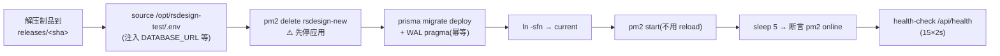

# 02 附录 · 旧试点 PM2/SQLite as-built（已退出治理）

> 从 `02-CI与自动部署流水线.md` §1–§6 原样迁出（Issue #371，2026-10-17）。该试点仓库自 #252 起已退出平台治理，本文只作历史证据，不是任何项目的部署步骤，不得复制给新项目或在 `gitea-ci` 执行。

下文 §1–§7 保留为 `rsdesign-new` PM2/SQLite as-built legacy adapter 的真实证据。不得把它
改写成 Docker 已部署，也不得在应用独立迁移验收前强制退出 PM2。

> `rsdesign-new` 自 #252 起已退出平台治理（仓库、历史、分支保护均保留）。本册对它的
> 全部描述自此只作历史证据，不再表示平台在册项目或当前部署入口。

## 1. 目标应用的真实形态（决定一切口径）

| 事实 | 影响 |
|------|------|
| Next.js 14 单体全栈（App Router），**不是** backend/frontend 分离 | 命令全在仓库根：`npm ci` / `npm test` / `npm run build`；Nginx 纯反代无静态分流 |
| SQLite + Prisma（`DATABASE_URL` 支持覆盖，默认 `file:../storage/db/app.db` 相对 schema 解析） | 部署脚本一整套 SQLite 特有约束（见 §4） |
| 端口写死 3100；`"type":"module"` | PM2 配置必须 `ecosystem.config.cjs` |
| 包管理 npm（独立仓库有自己的 package-lock.json） | CI 用 `npm ci`；Verdaccio 缓存 |
| 字体 `@fontsource-variable/*` 自托管 | **构建零外网依赖**（🕳️ #1：next/font/google 会在构建期拉 Google Fonts 挂死） |

## 2. 两条工作流

### `.gitea/workflows/ci.yml` —— PR 检查（分支保护的硬门）

```
PR → npm ci → prisma generate → 空库 migrate deploy → npm test(Vitest 串行) → next build
```

- 状态 context 为 **`CI / test (pull_request)`**，分支保护按此名放行合并——改 workflow/job 名会连带影响保护规则，慎改。
- 空库迁移 + 测试：service 层测试直连 SQLite，`rm -f storage/db/app.db*` 后 `migrate deploy` 重建，保证每次可重现。
- docs-only 的 PR 也跑全量（顺带回归）。

### `.gitea/workflows/deploy-test.yml` —— 历史合并 main 同机部署

```
push(main) → npm ci → generate → build → pack.sh <sha> → deploy-local-test.sh <sha> → health-check.sh
```

这是 `rsdesign-new` 试点的 as-built，不是当前平台允许的新目标。迁移后的应用仓 workflow
应在 `scm-ci` 构建并发布带 checksum 的制品，再由独立、受保护的 AppServer 部署入口验证
`role=appserver-test` 后执行 deploy；对应改动必须在该应用自己的 Issue/分支/PR 中完成。

## 3. 制品（scripts/pack.sh）

```
rsdesign-new-<sha>.tar.gz  (~160MB,存 /opt/artifacts/)
├── app/
│   ├── .next/            # 构建产物(已剔除 .next/cache)
│   ├── node_modules/     # 仅生产依赖(npm ci --omit=dev;prisma CLI 在 dependencies,离线可迁移)
│   ├── prisma/           # schema + migrations + enable-wal.sql
│   ├── package.json / package-lock.json / next.config.mjs
└── ecosystem.config.cjs
```

关键守门：**打包前校验 `.next/BUILD_ID` 存在**（🕳️ #2：Next 收到 SIGTERM 会以 exit 0 退出，`bash -e` 的 CI 步骤误判成功，半成品混入制品）。

`/opt/artifacts` 只是 legacy staging，不等于可以按名称或年龄清理。retention inventory 必须
使用项目 allowlist、完整 commit SHA、计算得到的 checksum、当前 release/rollback/workflow
引用、最小保留数量与期限；默认只输出 dry-run/audit ledger。任何删除仍是独立人工 Gate。

> 为什么不用 Next standalone：`prisma migrate deploy` 在离线机需要完整 prisma CLI，standalone 裁剪后还得单独拼装迁移工具链；SQLite 单机场景制品体积不敏感，全量 node_modules 简单可靠。可作后续优化项。

## 4. Legacy 部署（scripts/deploy-local-test.sh）—— SQLite 约束全在这



迁移到 AppServer 时保留以下 SQLite 顺序，但在读取 `.env`、停止进程、迁移数据库、切换
symlink 或启动 PM2 之前，root-owned wrapper 必须先验证 `deploy/application`、
`use/business-database`、`run/migration`、`stop/application` 和 `start/application` 等固定
capability。`scm-ci` 不能通过这些检查；不能以“runner 过去能执行”为兼容理由绕过。

每步的「为什么」：

| 步骤 | 原因（实证编号见运维手册） |
|------|------|
| SQLite 库在 `shared/db/app.db`（releases 之外），`.env` 用**绝对** `file:` 路径 | 库随版本切换不丢；相对路径会解析到 release 内 |
| **先停应用再迁移** | 🕳️ #10：`migrate deploy` 要独占锁，运行中应用持连接 → `database is locked`。停机窗口 = 迁移+启动，秒级 |
| `pm2 delete + start`，不用 reload | 🕳️ #3：PM2 reload **不应用**新配置里的 cwd/script，会钉死旧 release |
| 部署后断言 `pm2 jlist` 里进程 `online` | 🕳️ #4：健康检查可能被同端口野生进程骗过（发生过） |
| 迁移后执行 `enable-wal.sql`（幂等） | WAL 模式提升读写并发；注意 WAL 下备份要用 `sqlite3 .backup` 而非 cp |
| 单实例 fork（不用 cluster） | SQLite 单写者约束；「零停机」让位于确定性 |

历史环境文件 `/opt/rsdesign-test/.env` 已随 Issue #21 旧 runtime 清理；其字段设计只保留在对应
Change evidence 中，不是当前 `gitea-ci` 配置入口。现有应用配置必须从各自 AppServer profile 和
部署合同解析，不得按本段重建。

## 5. 回滚

| 层面 | 方式 |
|------|------|
| 应用 | `releases/` 按 sha 多版本保留：`ln -sfn releases/<旧sha> current && pm2 delete rsdesign-new && pm2 start current/ecosystem.config.cjs --env production` |
| 数据库 | 迁移前备份（`sqlite3 app.db ".backup <file>"`）；迁移设计要求向后兼容（先加列不删列，下线分两步） |
| 流程 | Gitea revert PR → 触发正常部署流程 |

## 6. 历史 `prod-sim` promote（已退役）

`scripts/promote-to-prod.sh <sha>` 曾设计为以 gitea-runner 身份在 gitea-ci 上手动运行，
rsync 制品到 `deployer@prod-sim.orb.local:/opt/incoming/`，再远程执行生产脚本。

**最终状态（2026-08-04）**：Issue #21 对 name+ID、依赖、唯一数据、owner disposition 与可重建
基线完成两轮核对后，只对精确目标执行 `orb delete --force prod-sim`；删除后 absence 与
`gitea-ci`/AppServer paired health 均通过。这个脚本不得再触发，也不能继续作为“下一个待办”。
应用仓中的 stale target 只能在自己的 Issue/PR 中删除或替换；新生产目标必须有
`appserver-prod` profile、不可变制品和独立审批合同。最终证据见 Issue #21 verification。
